<div align="center">

<a href="https://www.linkedin.com/in/renan-costa-barros"></a>

<a href="https://www.linkedin.com/in/renan-costa-barros"></a>
<a href="mailto:renanbarros.tech@gmail.com"></a>
<a href="https://portfolio-software-engineer-five.vercel.app"></a>


<br><br>

<a href="#-escolha-a-sua-trilha"></a>
<a href="#-ao-vivo"></a>
<a href="#-trajetória"></a>
<a href="#-projeto-atual--rkf-bank"></a>
<a href="#️-projetos-em-destaque"></a>
<a href="#-junior--pleno--onde-estou"></a>
<br>
<a href="#-pdi--roadmap-2026"></a>
<a href="#️-tecnologias"></a>
<a href="#-atuação-profissional"></a>
<a href="#-pergunte-ao-renan"></a>
<a href="#-formação-e-certificações"></a>

<br><br>


</div>


## 🎮 Escolha a sua trilha

> Clique na trilha que mais combina com você. Cada uma abre um caminho diferente pelo meu perfil.
> 👇 Os botões abrem e fecham.

<details>
<summary></summary>
<br>

<!-- AUTO:recrutador:START -->
| Pergunta | Resposta rápida |
| --- | --- |
| Quem é? | Dev **Full Stack** em transição de carreira, focado em **Next.js + TypeScript**, rumo ao **Pleno** (**11/19** competências já praticadas) |
| Melhor projeto? | **[RKF Bank](https://github.com/k3vinrich4rd/rkf_bank)**: banco digital em dupla; eu faço o **frontend** (8/20 itens do MVP prontos) |
| Stack principal? | Next.js · React · TypeScript · Tailwind CSS · Node.js · Prisma · PostgreSQL · Better Auth |
| O que está estudando? | Testes com Vitest e Testing Library → System design → Inglês técnico → Lógica de programação (livro) |
| Contato? | [LinkedIn](https://www.linkedin.com/in/renan-costa-barros) · <renanbarros.tech@gmail.com> |
<!-- AUTO:recrutador:END -->

<a href="https://www.linkedin.com/in/renan-costa-barros"></a>
<a href="mailto:renanbarros.tech@gmail.com"></a>

<details>
<summary><b>👉 Quero ver evidências</b></summary>
<br>

- Régua de competências com evidência por projeto: [📈 Junior → Pleno](#-junior--pleno--onde-estou)
- O que eu construí no frontend do RKF Bank: [🏦 Projeto atual](#-projeto-atual--rkf-bank)
- Uma IA que monta treinos chamando funções de verdade: [🏋️ Treinos API](#-os-dois-que-eu-mostraria-numa-entrevista)
- Perguntas técnicas respondidas com o que eu fiz: [💬 Pergunte ao Renan](#-pergunte-ao-renan)

</details>

</details>

<details>
<summary></summary>
<br>

Sugestão de leitura, do mais simples ao mais completo:

1. 💣 **[Campo Minado](https://github.com/renanbarrostech-cmd/Campo-Minado)**: JavaScript puro, flood fill recursivo, [jogável no navegador](https://campo-minado-cyan.vercel.app).
2. ✅ **[Task Manager](https://github.com/renanbarrostech-cmd/FSC-TASK-MANEGER-BACKEND)**: API em Node.js + Express + MongoDB, com controllers, models e erros separados, e o [frontend em React](https://github.com/renanbarrostech-cmd/FSC-TASK-MANEGER-FRONTEND).
3. 🏋️ **[Treinos API](https://github.com/renanbarrostech-cmd/treinos-api)**: Fastify + Zod + Prisma, regras em *use cases* e um personal trainer de IA com *tool calling*.
4. 💇 **[BellaFlow](https://github.com/renanbarrostech-cmd/bella-flow)**: Next.js 16 + Prisma 7 + Neon, com um chat processado por um workflow do n8n.
5. 🏦 **[RKF Bank](https://github.com/k3vinrich4rd/rkf_bank/tree/develop/frontend)**: o frontend de um banco digital feito em dupla.

<details>
<summary><b>👉 Onde olhar primeiro no RKF Bank</b></summary>
<br>

| Arquivo | Por que é interessante |
| --- | --- |
| `frontend/lib/api/client.ts` | um cliente HTTP só, tipado, para todas as chamadas |
| `frontend/lib/logger/mascara.ts` | o log esconde CPF, e-mail, telefone e nome antes de escrever (LGPD) |
| `frontend/lib/masks.ts` | máscaras de CPF, CEP e telefone nos formulários |
| `frontend/components/cadastro/use-cadastro-form.ts` | a lógica do formulário separada da tela |
| `frontend/components/conta/use-conta-atual.ts` | como a conta volta para a tela sem login no MVP |

</details>

</details>

<details>
<summary></summary>
<br>

Eu comecei em 2023 como **jovem aprendiz numa transportadora**, mexendo com planilhas, notas fiscais e faturamento. Hoje sou assistente financeiro lá e, em paralelo, construo software. O caminho que funcionou para mim:

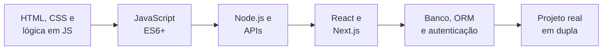

Duas dicas que eu daria para quem está onde eu estava:

- **Resolva um problema que você conhece de perto.** Eu entendia as rotinas do escritório antes de entender React, e isso me ajudou a saber *o que* construir antes de saber *como*.
- **Um projeto em dupla ensina o que tutorial não ensina:** contrato de API, Pull Request, revisão e combinar decisões por escrito.

</details>


## 📡 Ao vivo

> Esta seção se atualiza sozinha. Cada commit que eu faço alimenta o meu Obsidian, que alimenta este README. 🤖


<!-- AUTO:status:START -->
   
<!-- AUTO:status:END -->

<!-- AUTO:agora:START -->
<details open>
<summary><b>🔥 Esta semana</b></summary>
<br>

- 🔨 Decidir como o usuário volta para a conta: o Kevin registrou a decisão do login em 16/10 (`cb615d7`), falta conferir
- 🔨 Integrar o login (CPF + senha, JWT) no frontend: o backend ficou pronto em 16/10
- 🔨 Trocar a busca página a página por `GET /contas/{contaId}` quando o endpoint existir
- 🎯 Foco de estudo: **Testes com Vitest e Testing Library**: Escrever o primeiro teste do `use-cadastro-form` no RKF Bank
- ✅ Última entrega: Tela da conta com saldo, dados e ID para transferências (2026-10-14)

</details>
<!-- AUTO:agora:END -->

<!-- AUTO:dica:START -->
> 💡 **Dica do dia: `Máscara não é validação`**  
> Formatar o CPF no input ajuda quem digita, mas a regra (dígitos verificadores, unicidade) precisa ser validada no servidor.  
> <sub>Muda todo dia sozinha · 6/20</sub>
<!-- AUTO:dica:END -->

<picture>
  <source media="(prefers-color-scheme: dark)" srcset="https://raw.githubusercontent.com/renanbarrostech-cmd/renanbarrostech-cmd/output/snake-dark.svg">
  
</picture>

<!-- AUTO:atividade:START -->
<details open>
<summary><b>⚡ Meus últimos commits</b></summary>
<br>

|  | Repositório | Commit | Quando |
| --- | --- | --- | --- |
| 📝 | [`rkf_bank`](https://github.com/k3vinrich4rd/rkf_bank) | [`51cff1e`](https://github.com/k3vinrich4rd/rkf_bank/commit/51cff1ecb57db943712813518d764a80c3f1d1c3) docs(planing): marca no roadmap as telas da conta, movimentacoes e extrato | 17/10/2026 |
| 📝 | [`rkf_bank`](https://github.com/k3vinrich4rd/rkf_bank) | [`726123c`](https://github.com/k3vinrich4rd/rkf_bank/commit/726123cdb549342e9834e4f506b35df6199a97bd) docs: decisao do token em cookie httpOnly, recado ao Kevin e README do login | 17/10/2026 |
| ♻️ | [`rkf_bank`](https://github.com/k3vinrich4rd/rkf_bank) | [`15be287`](https://github.com/k3vinrich4rd/rkf_bank/commit/15be287066f02b51fc96ac9b2351a91f8cc57e5a) refactor(conta): usa as contas do usuario logado no lugar do localStorage | 17/10/2026 |
| ✨ | [`rkf_bank`](https://github.com/k3vinrich4rd/rkf_bank) | [`c79ca5e`](https://github.com/k3vinrich4rd/rkf_bank/commit/c79ca5e2fb266cc0a64c48ef2e2e1c4676dc13e9) feat(auth): login com JWT em cookie httpOnly e senha no cadastro | 17/10/2026 |
| 📌 | [`FSC-TASK-MANEGER-FRONTEND`](https://github.com/renanbarrostech-cmd/FSC-TASK-MANEGER-FRONTEND) | [`f3be3b0`](https://github.com/renanbarrostech-cmd/FSC-TASK-MANEGER-FRONTEND/commit/f3be3b05b65ecf5655de3fb63d76761dea05826c) PDF: ciclos da vida de um component | 11/10/2026 |
| ♻️ | [`FSC-TASK-MANEGER-FRONTEND`](https://github.com/renanbarrostech-cmd/FSC-TASK-MANEGER-FRONTEND) | [`1f2a842`](https://github.com/renanbarrostech-cmd/FSC-TASK-MANEGER-FRONTEND/commit/1f2a842c8328339b8c3c47f2902836de403bed9d) refactor: acess lifecycle methods in function components | 11/10/2026 |
| ✨ | [`FSC-TASK-MANEGER-FRONTEND`](https://github.com/renanbarrostech-cmd/FSC-TASK-MANEGER-FRONTEND) | [`9bac2d2`](https://github.com/renanbarrostech-cmd/FSC-TASK-MANEGER-FRONTEND/commit/9bac2d21a49ad310f9416fb1600643fcff485ae7) feat: add lifecycle methods to our components | 11/10/2026 |
| ♻️ | [`FSC-TASK-MANEGER-FRONTEND`](https://github.com/renanbarrostech-cmd/FSC-TASK-MANEGER-FRONTEND) | [`5a66b48`](https://github.com/renanbarrostech-cmd/FSC-TASK-MANEGER-FRONTEND/commit/5a66b48395874e2e9e3670d63353b3dc5c80db8e) refactor: convert component to Class | 11/10/2026 |

<sub>✨ feat · 🐛 fix · 🧪 test · 📝 docs · 🔧 chore/build/ci · ♻️ refactor | 🤖 atualizado sozinho a cada 6 horas · 18/10 às 01:46</sub>

</details>
<!-- AUTO:atividade:END -->

<!-- AUTO:diario:START -->
<details>
<summary><b>📓 Diário de bordo: o que cada entrega me ensinou</b></summary>
<br>

| Quando | Onde | O que eu aprendi |
| --- | --- | --- |
| 2026-10-12 | `refactor/contrato-api-e-logs` | logar sem expor dados pessoais: mascarar CPF, e-mail, telefone e nome antes de escrever (LGPD) |
| 2026-10-11 | `feature/tela-cadastro-cliente` | o contrato da API é a regra entre front e back: mudou a rota, muda o contrato no mesmo PR |
| 2026-10-04 | `develop` | `.env` nunca vai para o Git; segredo vazado precisa ser trocado, não só apagado |

**2026-10-16**
- ✅ RKF Bank: merge do PR #23 (`feature/flyway`) na `develop`
- ✅ Montei o segundo cérebro no Obsidian

**2026-10-14**
- ✅ RKF Bank: tela de abertura de conta e conta guardada no navegador (`0a91720`, `feature/tela-abrir-conta`)
- ✅ RKF Bank: tela da conta com saldo, dados e ID para transferências (`c439676`, `feature/tela-conta`)

</details>
<!-- AUTO:diario:END -->

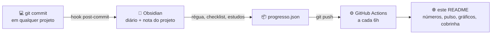


## 🧭 Trajetória


<div align="center">


</div>

> Osasco, SP. Dev Full Stack em transição de carreira. Sempre estudando, sempre entregando.

Entrei no mercado em **2023 como jovem aprendiz** numa transportadora. Em três anos fui promovido **quatro vezes**: jovem aprendiz → auxiliar de escritório → auxiliar financeiro → **assistente financeiro**. Foi lá que aprendi a enxergar processos, planilhas e retrabalho, e a pensar em como o software pode resolver isso.

Em paralelo, estudo desenvolvimento todos os dias: **Gestão da Tecnologia da Informação** na Estácio, a **Formação Full Stack do DevClub** (140 h) e as formações do **Full Stack Club**. Hoje faço o **frontend do [RKF Bank](#-projeto-atual--rkf-bank)** em dupla com o [Kevin Richard](https://github.com/k3vinrich4rd).

> *Primeiro, resolva o problema. Depois, escreva o código.*

<details>
<summary><b>📍 De onde eu codo (mapa interativo: arraste e dê zoom)</b></summary>
<br>

```geojson
{
  "type": "FeatureCollection",
  "features": [
    {
      "type": "Feature",
      "properties": {
        "title": "Osasco, SP",
        "description": "Renan Barros — Dev Full Stack",
        "marker-color": "#8B5CF6",
        "marker-size": "large",
        "marker-symbol": "rocket"
      },
      "geometry": { "type": "Point", "coordinates": [-46.7917, -23.5329] }
    }
  ]
}
```

</details>

<details>
<summary><b>📅 Ver minha linha do tempo</b></summary>
<br>

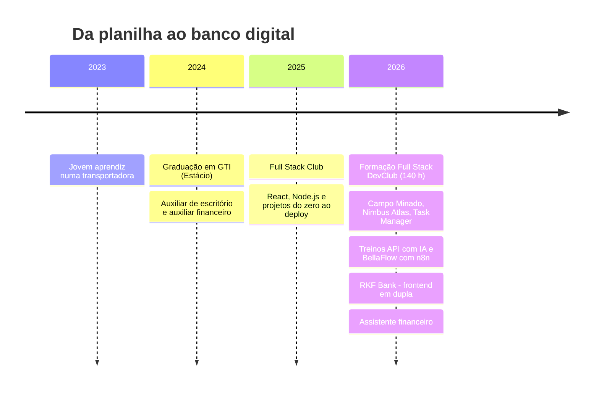

</details>


## 🚀 Sobre mim


<details>
<summary><b>📄 Ver como texto (para copiar)</b></summary>
<br>

```ts
const renan = {
  nome: "Renan Barros",
  cidade: "Osasco, SP",
  papel: "Dev Full Stack · Junior → Pleno",
  stack: ["Next.js", "React", "TypeScript", "Node.js", "PostgreSQL"],
  aprendendo: ["testes no front", "CI/CD", "performance", "inglês"],
  veioDe: "planilhas, notas fiscais e faturamento",
} as const;

export function proximoPasso() {
  return "Entregar o MVP do RKF Bank e chegar ao Pleno.";
}
```

</details>


## 🏦 Projeto atual — RKF Bank

[](https://github.com/k3vinrich4rd/rkf_bank/commits/develop)
[](https://github.com/k3vinrich4rd/rkf_bank/pulse)
[](https://github.com/k3vinrich4rd/rkf_bank/pulls?q=is%3Apr+is%3Aclosed)


-Java%20%2B%20Spring%20Boot-6DB33F?style=flat-square&logo=springboot&logoColor=white)

> Banco digital **full stack** feito em dupla. **Eu cuido do frontend** em Next.js: landing page, cadastro com endereço pelo CEP, abertura de conta e tela da conta. O **[Kevin Richard](https://github.com/k3vinrich4rd)** cuida do backend em Java e Spring Boot. A meta é o MVP no ar até **31/10/2026**.

<a href="https://github.com/k3vinrich4rd/rkf_bank/tree/develop/frontend"></a>
<a href="https://github.com/k3vinrich4rd/rkf_bank#readme"></a>


<details>
<summary><b>🗺️ Mapa das telas (o que está pronto e o que falta)</b></summary>
<br>

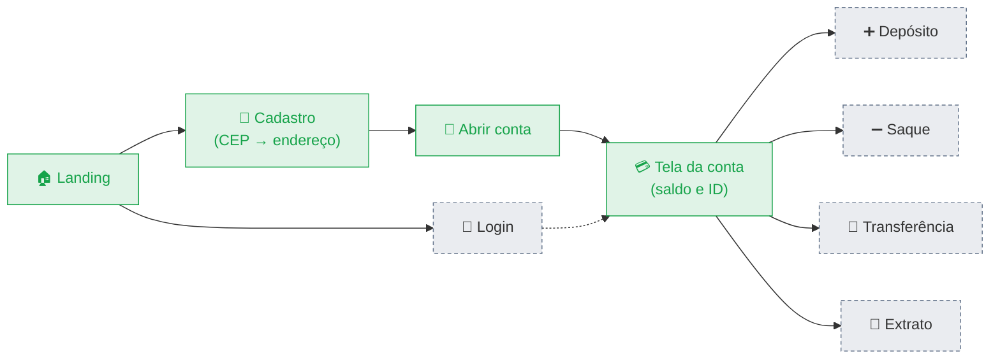

<sub>Verde: pronto · Tracejado: falta. A página de login existe só no visual; a integração com o JWT do backend é o próximo passo.</sub>

</details>

<details>
<summary><b>🧭 Jornada do cliente no front</b></summary>
<br>

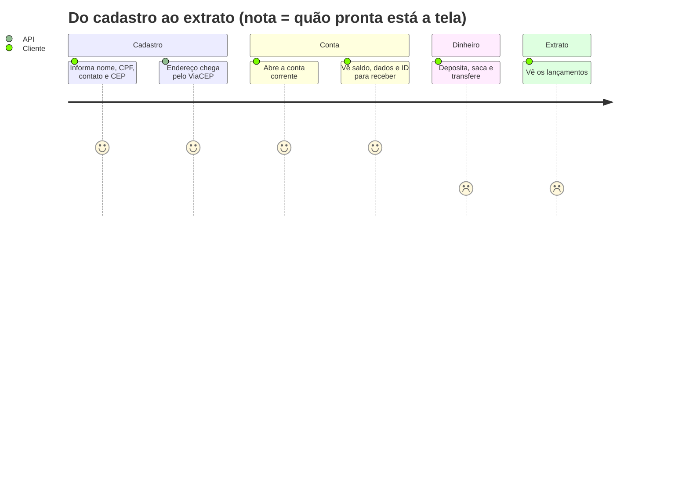

</details>

<details>
<summary><b>🔁 O cadastro com CEP, passo a passo</b></summary>
<br>

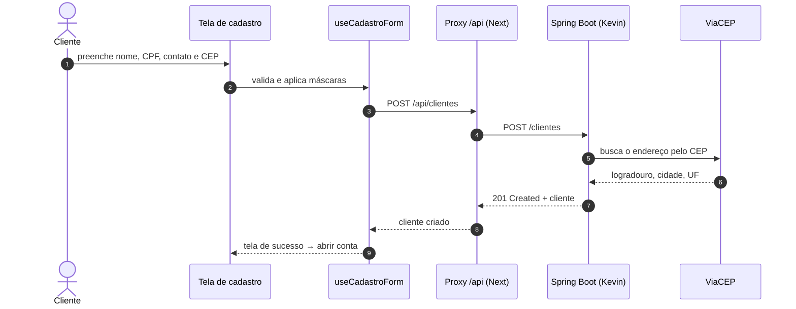

</details>

<details>
<summary><b>🖥️ O que eu entreguei no frontend</b></summary>
<br>

| Entrega | O que tem de interessante |
| --- | --- |
| Landing page institucional | identidade visual da marca RKF, seções de recursos, segurança e FAQ |
| Cadastro de cliente | máscaras de CPF, CEP e telefone, e lógica do formulário num hook separado da tela |
| Abertura de conta | a conta fica guardada no navegador, porque o MVP ainda não tem login |
| Tela da conta | saldo, dados e o ID para receber transferências |
| Camada de API | um cliente HTTP tipado + serviços de clientes e contas, chamados por um proxy no Next |
| Logs | todo log passa por um logger que mascara dados pessoais (LGPD) |
| Documentação | revisão da documentação do projeto inteiro e do contrato da API |

</details>

<details>
<summary><b>🔎 Logs que não vazam dados pessoais</b></summary>
<br>

```ts
// frontend/lib/logger/mascara.ts (trecho)
// 52998224725 → ***.***.247-25
cpf: (valor) => {
  const digitos = valor.replace(/\D/g, "");
  return digitos.length === 11 ? `***.***.${digitos.slice(6, 9)}-${digitos.slice(9)}` : OCULTO;
},
```

O logger aplica a máscara **antes** de escrever: quem loga não precisa lembrar. Para proteger um campo novo, basta adicioná-lo ao mapa de máscaras.

</details>

<details>
<summary><b>🧪 Qualidade no front: o que já tem e o que falta (sem maquiagem)</b></summary>
<br>

| Prática | Situação |
| --- | --- |
| TypeScript + ESLint (`eslint-config-next`) | ✅ em todo o frontend |
| Cliente HTTP único e tipos do contrato da API | ✅ `lib/api/types.ts` |
| Logs com dados pessoais mascarados | ✅ `lib/logger` |
| Testes automatizados no front | 🔄 próximo passo: Vitest + Testing Library |
| CI do front (lint, typecheck e build em todo PR) | ⏳ planejado (o backend já tem) |
| Dependências sem CVE conhecida | ⏳ CVEs do `next` 16.3.6 mapeadas, correção pendente |

</details>

<details>
<summary><b>🤝 Como a dupla se organiza</b></summary>
<br>

- **Contrato da API** é a regra entre front e back: se uma rota muda, o contrato muda no mesmo PR.
- **Decisões registradas** com data e motivo (`planing/decisoes.md`), e **recados** entre nós dois (`planing/recados.md`).
- **Branches por feature** e Pull Requests revisados, com **commits semânticos**.

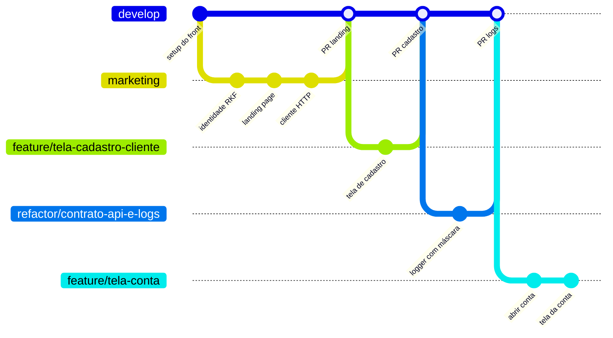

</details>


## 🗂️ Projetos em destaque

### ⭐ Os dois que eu mostraria numa entrevista

<div align="center">

<a href="https://github.com/k3vinrich4rd/rkf_bank"></a>
<a href="https://github.com/renanbarrostech-cmd/treinos-api"></a>

</div>

|  | 🏦 [RKF Bank](https://github.com/k3vinrich4rd/rkf_bank) | 🏋️ [Treinos API](https://github.com/renanbarrostech-cmd/treinos-api) |
| --- | --- | --- |
| **O que é** | banco digital full stack, feito em dupla | API de planos de treino com um personal trainer de IA (bootcamp Full Stack Club) |
| **Meu papel** | todo o frontend | projeto individual |
| **Domínio** | cliente, conta, saldo, depósito, saque, transferência, extrato | usuário, plano de treino, dias, sessões e estatísticas |
| **O que mostra** | proxy de API no Next, cliente HTTP tipado, logs com máscara (LGPD), trabalho em dupla com PRs | regras em *use cases* separadas das rotas, schemas Zod, documentação interativa e IA com *tool calling* |
| **Stack** | Next.js 16 · React 19 · TypeScript · Tailwind 4 · shadcn/ui | Fastify · Zod · Prisma · Better Auth · AI SDK |
| **Ver primeiro** | [`lib/api/client.ts`](https://github.com/k3vinrich4rd/rkf_bank/tree/develop/frontend/lib/api) · [`lib/logger`](https://github.com/k3vinrich4rd/rkf_bank/tree/develop/frontend/lib/logger) | [`src/routes/ai.ts`](https://github.com/renanbarrostech-cmd/treinos-api/blob/HEAD/src/routes/ai.ts) · [`src/usecases`](https://github.com/renanbarrostech-cmd/treinos-api/tree/HEAD/src/usecases) |

### 🧩 Outros projetos que valem o clique

<div align="center">

<a href="https://github.com/renanbarrostech-cmd/bella-flow"></a>
<a href="https://github.com/renanbarrostech-cmd/treinos-frontend"></a>
<a href="https://github.com/renanbarrostech-cmd/Nimbus-Atlas"></a>
<a href="https://github.com/renanbarrostech-cmd/FSC-TASK-MANEGER-BACKEND"></a>

</div>

|  | Projeto | Por que vale a pena olhar | Stack |
| --- | --- | --- | --- |
| 💇 | **[BellaFlow](https://github.com/renanbarrostech-cmd/bella-flow)** | automação de atendimento para salões, com chat processado pelo n8n | Next.js 16 · Prisma 7 · Neon · n8n |
| 📱 | **[Treinos Frontend](https://github.com/renanbarrostech-cmd/treinos-frontend)** | cliente HTTP gerado direto da especificação da API (Orval) | Next.js · TypeScript · Tailwind |
| 🌩️ | **[Nimbus Atlas](https://github.com/renanbarrostech-cmd/Nimbus-Atlas)** | países e clima em tempo real com duas APIs públicas | HTML · CSS · JavaScript |
| ✅ | **[Task Manager](https://github.com/renanbarrostech-cmd/FSC-TASK-MANEGER-BACKEND)** | API REST com controllers, models e tratamento de erros separados | Node.js · Express · MongoDB |
| ⚽ | **[Fut de Sexta](https://github.com/renanbarrostech-cmd/futdelta)** | sorteio dos times da pelada: marca quem vem e sorteia em um toque | HTML · CSS · JavaScript |
| 💣 | **[Campo Minado](https://github.com/renanbarrostech-cmd/Campo-Minado)** | flood fill recursivo, sem dependências, [jogável](https://campo-minado-cyan.vercel.app) | JavaScript |

<details>
<summary><b>🏋️ Treinos API — um personal trainer de IA que chama funções de verdade</b></summary>
<br>


| Funcionalidade | Detalhe |
| --- | --- |
| Planos de treino | criar, listar e detalhar planos, com dias e sessões de treino |
| Sessões | iniciar e atualizar a sessão de um dia de treino |
| Estatísticas e home | dados agregados para o painel do usuário |
| Personal trainer de IA | o chat chama *tools* tipadas: lê os dados do usuário, salva peso e altura e cria o plano |
| Arquitetura | rotas finas e regras em *use cases* (`CreateWorkoutPlan`, `StartWorkoutSession`…) |
| Documentação | Swagger + referência interativa com Scalar |

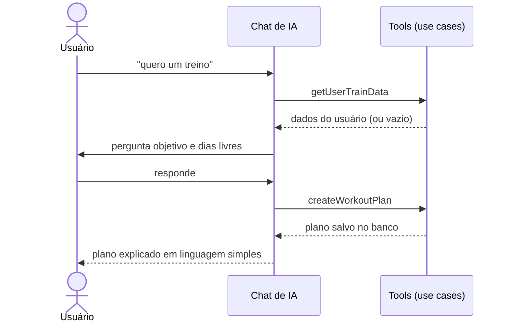

🔗 **[treinos-api](https://github.com/renanbarrostech-cmd/treinos-api)** · **[treinos-frontend](https://github.com/renanbarrostech-cmd/treinos-frontend)**

</details>

<details>
<summary><b>💇 BellaFlow — automação de atendimento para salões</b></summary>
<br>

| Tela | O que faz |
| --- | --- |
| Dashboard | cards de indicadores, gráfico de crescimento e agenda do dia |
| Agendamentos | calendário do mês e tabela completa de horários |
| Clientes | base com WhatsApp, último atendimento e serviços |
| Automação n8n | explica o fluxo passo a passo e mostra o status da conexão |
| Conversas | chat estilo WhatsApp ligado de verdade ao backend |

**O detalhe de produto:** com o n8n configurado, a mensagem vai para o workflow, que responde por um callback. Sem ele, o próprio app responde por regras de palavra-chave, sem custo de IA. Assim a demonstração funciona na frente do cliente mesmo antes da integração.

🔗 **[bella-flow](https://github.com/renanbarrostech-cmd/bella-flow)**

</details>

<details>
<summary><b>🌩️ Nimbus Atlas — países e clima em tempo real</b></summary>
<br>

- Busca um país pelo nome e mostra bandeira, capital, população, região e moeda (**REST Countries API**).
- Consulta o clima da capital sob demanda pelas coordenadas (**Open-Meteo API**).
- Sem framework: HTML, CSS e JavaScript puro, com tema escuro.

🔗 **[Nimbus-Atlas](https://github.com/renanbarrostech-cmd/Nimbus-Atlas)**

</details>

<details>
<summary><b>📦 Outros repositórios que contam a minha evolução</b></summary>
<br>

| Tema | Repositórios |
| --- | --- |
| Fundamentos de JavaScript | [Lógica com JavaScript (livro)](https://github.com/renanbarrostech-cmd/Logica-com-JavaScript-livro) · [JavaScript ES6+](https://github.com/renanbarrostech-cmd/CURSO_JAVASCRIPT_ES6-) · [Calculator](https://github.com/renanbarrostech-cmd/Calculator) · [Whiteboard](https://github.com/renanbarrostech-cmd/Whiteboard) |
| Node.js | [Node.js assíncrono](https://github.com/renanbarrostech-cmd/NODE_JS_ASSINCRONO) · [Módulos no Node.js](https://github.com/renanbarrostech-cmd/MODULOS_NO_NODE_JS) · [Task Manager (back)](https://github.com/renanbarrostech-cmd/FSC-TASK-MANEGER-BACKEND) |
| React e Next.js | [Task Manager (front)](https://github.com/renanbarrostech-cmd/FSC-TASK-MANEGER-FRONTEND) · [Treinos Frontend](https://github.com/renanbarrostech-cmd/treinos-frontend) · [DevBarros Vendas](https://github.com/renanbarrostech-cmd/devbarros-vendas) · [Mini game](https://github.com/renanbarrostech-cmd/mini-game) · [Portfólio v1](https://github.com/renanbarrostech-cmd/portfolio-devbarrostech) |
| Pensando como produto | [BellaFlow](https://github.com/renanbarrostech-cmd/bella-flow) · [Vertex Systems](https://github.com/renanbarrostech-cmd/Vertex-Systems) (requisitos de cliente simulados) · [Fut de Sexta](https://github.com/renanbarrostech-cmd/futdelta) · [Nimbus Atlas](https://github.com/renanbarrostech-cmd/Nimbus-Atlas) |
| Ferramentas | [Curso de Git e GitHub](https://github.com/renanbarrostech-cmd/CURSO_GIT_E_GITHUB) |

</details>

<!-- AUTO:repos:START -->
<details>
<summary><b>📊 Meus 19 repositórios públicos em números</b></summary>
<br>

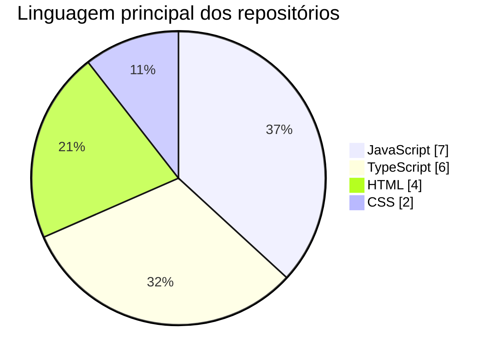

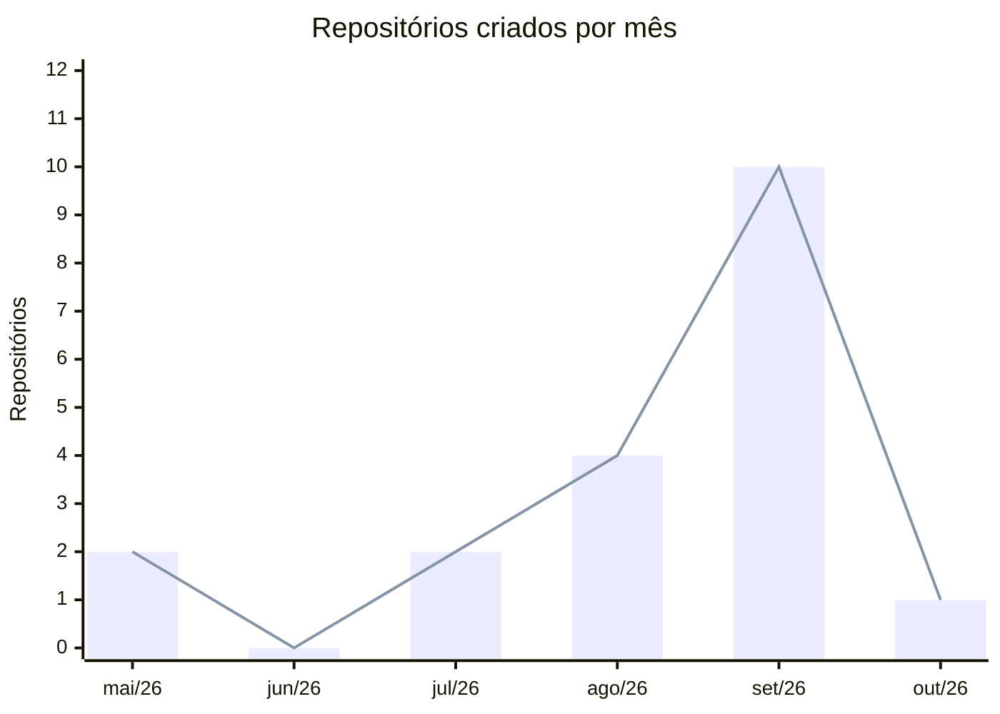

**🧊 Os mesmos números em 3D** (gire com o mouse, dê zoom com a roda). Da esquerda para a direita: mai/26, jun/26, jul/26, ago/26, set/26, out/26.

```stl
solid repositorios_por_mes
  facet normal 0 0 -1
    outer loop
      vertex -4.000 -4.000 -1.000
      vertex -4.000 12.000 -1.000
      vertex 72.000 12.000 -1.000
    endloop
  endfacet
  facet normal 0 0 -1
    outer loop
      vertex -4.000 -4.000 -1.000
      vertex 72.000 12.000 -1.000
      vertex 72.000 -4.000 -1.000
    endloop
  endfacet
  facet normal 0 0 1
    outer loop
      vertex -4.000 -4.000 0.000
      vertex 72.000 -4.000 0.000
      vertex 72.000 12.000 0.000
    endloop
  endfacet
  facet normal 0 0 1
    outer loop
      vertex -4.000 -4.000 0.000
      vertex 72.000 12.000 0.000
      vertex -4.000 12.000 0.000
    endloop
  endfacet
  facet normal 0 -1 0
    outer loop
      vertex -4.000 -4.000 -1.000
      vertex 72.000 -4.000 -1.000
      vertex 72.000 -4.000 0.000
    endloop
  endfacet
  facet normal 0 -1 0
    outer loop
      vertex -4.000 -4.000 -1.000
      vertex 72.000 -4.000 0.000
      vertex -4.000 -4.000 0.000
    endloop
  endfacet
  facet normal 0 1 0
    outer loop
      vertex -4.000 12.000 -1.000
      vertex -4.000 12.000 0.000
      vertex 72.000 12.000 0.000
    endloop
  endfacet
  facet normal 0 1 0
    outer loop
      vertex -4.000 12.000 -1.000
      vertex 72.000 12.000 0.000
      vertex 72.000 12.000 -1.000
    endloop
  endfacet
  facet normal -1 0 0
    outer loop
      vertex -4.000 -4.000 -1.000
      vertex -4.000 -4.000 0.000
      vertex -4.000 12.000 0.000
    endloop
  endfacet
  facet normal -1 0 0
    outer loop
      vertex -4.000 -4.000 -1.000
      vertex -4.000 12.000 0.000
      vertex -4.000 12.000 -1.000
    endloop
  endfacet
  facet normal 1 0 0
    outer loop
      vertex 72.000 -4.000 -1.000
      vertex 72.000 12.000 -1.000
      vertex 72.000 12.000 0.000
    endloop
  endfacet
  facet normal 1 0 0
    outer loop
      vertex 72.000 -4.000 -1.000
      vertex 72.000 12.000 0.000
      vertex 72.000 -4.000 0.000
    endloop
  endfacet
  facet normal 0 0 -1
    outer loop
      vertex 0.000 0.000 0.000
      vertex 0.000 8.000 0.000
      vertex 8.000 8.000 0.000
    endloop
  endfacet
  facet normal 0 0 -1
    outer loop
      vertex 0.000 0.000 0.000
      vertex 8.000 8.000 0.000
      vertex 8.000 0.000 0.000
    endloop
  endfacet
  facet normal 0 0 1
    outer loop
      vertex 0.000 0.000 6.400
      vertex 8.000 0.000 6.400
      vertex 8.000 8.000 6.400
    endloop
  endfacet
  facet normal 0 0 1
    outer loop
      vertex 0.000 0.000 6.400
      vertex 8.000 8.000 6.400
      vertex 0.000 8.000 6.400
    endloop
  endfacet
  facet normal 0 -1 0
    outer loop
      vertex 0.000 0.000 0.000
      vertex 8.000 0.000 0.000
      vertex 8.000 0.000 6.400
    endloop
  endfacet
  facet normal 0 -1 0
    outer loop
      vertex 0.000 0.000 0.000
      vertex 8.000 0.000 6.400
      vertex 0.000 0.000 6.400
    endloop
  endfacet
  facet normal 0 1 0
    outer loop
      vertex 0.000 8.000 0.000
      vertex 0.000 8.000 6.400
      vertex 8.000 8.000 6.400
    endloop
  endfacet
  facet normal 0 1 0
    outer loop
      vertex 0.000 8.000 0.000
      vertex 8.000 8.000 6.400
      vertex 8.000 8.000 0.000
    endloop
  endfacet
  facet normal -1 0 0
    outer loop
      vertex 0.000 0.000 0.000
      vertex 0.000 0.000 6.400
      vertex 0.000 8.000 6.400
    endloop
  endfacet
  facet normal -1 0 0
    outer loop
      vertex 0.000 0.000 0.000
      vertex 0.000 8.000 6.400
      vertex 0.000 8.000 0.000
    endloop
  endfacet
  facet normal 1 0 0
    outer loop
      vertex 8.000 0.000 0.000
      vertex 8.000 8.000 0.000
      vertex 8.000 8.000 6.400
    endloop
  endfacet
  facet normal 1 0 0
    outer loop
      vertex 8.000 0.000 0.000
      vertex 8.000 8.000 6.400
      vertex 8.000 0.000 6.400
    endloop
  endfacet
  facet normal 0 0 -1
    outer loop
      vertex 12.000 0.000 0.000
      vertex 12.000 8.000 0.000
      vertex 20.000 8.000 0.000
    endloop
  endfacet
  facet normal 0 0 -1
    outer loop
      vertex 12.000 0.000 0.000
      vertex 20.000 8.000 0.000
      vertex 20.000 0.000 0.000
    endloop
  endfacet
  facet normal 0 0 1
    outer loop
      vertex 12.000 0.000 0.600
      vertex 20.000 0.000 0.600
      vertex 20.000 8.000 0.600
    endloop
  endfacet
  facet normal 0 0 1
    outer loop
      vertex 12.000 0.000 0.600
      vertex 20.000 8.000 0.600
      vertex 12.000 8.000 0.600
    endloop
  endfacet
  facet normal 0 -1 0
    outer loop
      vertex 12.000 0.000 0.000
      vertex 20.000 0.000 0.000
      vertex 20.000 0.000 0.600
    endloop
  endfacet
  facet normal 0 -1 0
    outer loop
      vertex 12.000 0.000 0.000
      vertex 20.000 0.000 0.600
      vertex 12.000 0.000 0.600
    endloop
  endfacet
  facet normal 0 1 0
    outer loop
      vertex 12.000 8.000 0.000
      vertex 12.000 8.000 0.600
      vertex 20.000 8.000 0.600
    endloop
  endfacet
  facet normal 0 1 0
    outer loop
      vertex 12.000 8.000 0.000
      vertex 20.000 8.000 0.600
      vertex 20.000 8.000 0.000
    endloop
  endfacet
  facet normal -1 0 0
    outer loop
      vertex 12.000 0.000 0.000
      vertex 12.000 0.000 0.600
      vertex 12.000 8.000 0.600
    endloop
  endfacet
  facet normal -1 0 0
    outer loop
      vertex 12.000 0.000 0.000
      vertex 12.000 8.000 0.600
      vertex 12.000 8.000 0.000
    endloop
  endfacet
  facet normal 1 0 0
    outer loop
      vertex 20.000 0.000 0.000
      vertex 20.000 8.000 0.000
      vertex 20.000 8.000 0.600
    endloop
  endfacet
  facet normal 1 0 0
    outer loop
      vertex 20.000 0.000 0.000
      vertex 20.000 8.000 0.600
      vertex 20.000 0.000 0.600
    endloop
  endfacet
  facet normal 0 0 -1
    outer loop
      vertex 24.000 0.000 0.000
      vertex 24.000 8.000 0.000
      vertex 32.000 8.000 0.000
    endloop
  endfacet
  facet normal 0 0 -1
    outer loop
      vertex 24.000 0.000 0.000
      vertex 32.000 8.000 0.000
      vertex 32.000 0.000 0.000
    endloop
  endfacet
  facet normal 0 0 1
    outer loop
      vertex 24.000 0.000 6.400
      vertex 32.000 0.000 6.400
      vertex 32.000 8.000 6.400
    endloop
  endfacet
  facet normal 0 0 1
    outer loop
      vertex 24.000 0.000 6.400
      vertex 32.000 8.000 6.400
      vertex 24.000 8.000 6.400
    endloop
  endfacet
  facet normal 0 -1 0
    outer loop
      vertex 24.000 0.000 0.000
      vertex 32.000 0.000 0.000
      vertex 32.000 0.000 6.400
    endloop
  endfacet
  facet normal 0 -1 0
    outer loop
      vertex 24.000 0.000 0.000
      vertex 32.000 0.000 6.400
      vertex 24.000 0.000 6.400
    endloop
  endfacet
  facet normal 0 1 0
    outer loop
      vertex 24.000 8.000 0.000
      vertex 24.000 8.000 6.400
      vertex 32.000 8.000 6.400
    endloop
  endfacet
  facet normal 0 1 0
    outer loop
      vertex 24.000 8.000 0.000
      vertex 32.000 8.000 6.400
      vertex 32.000 8.000 0.000
    endloop
  endfacet
  facet normal -1 0 0
    outer loop
      vertex 24.000 0.000 0.000
      vertex 24.000 0.000 6.400
      vertex 24.000 8.000 6.400
    endloop
  endfacet
  facet normal -1 0 0
    outer loop
      vertex 24.000 0.000 0.000
      vertex 24.000 8.000 6.400
      vertex 24.000 8.000 0.000
    endloop
  endfacet
  facet normal 1 0 0
    outer loop
      vertex 32.000 0.000 0.000
      vertex 32.000 8.000 0.000
      vertex 32.000 8.000 6.400
    endloop
  endfacet
  facet normal 1 0 0
    outer loop
      vertex 32.000 0.000 0.000
      vertex 32.000 8.000 6.400
      vertex 32.000 0.000 6.400
    endloop
  endfacet
  facet normal 0 0 -1
    outer loop
      vertex 36.000 0.000 0.000
      vertex 36.000 8.000 0.000
      vertex 44.000 8.000 0.000
    endloop
  endfacet
  facet normal 0 0 -1
    outer loop
      vertex 36.000 0.000 0.000
      vertex 44.000 8.000 0.000
      vertex 44.000 0.000 0.000
    endloop
  endfacet
  facet normal 0 0 1
    outer loop
      vertex 36.000 0.000 12.800
      vertex 44.000 0.000 12.800
      vertex 44.000 8.000 12.800
    endloop
  endfacet
  facet normal 0 0 1
    outer loop
      vertex 36.000 0.000 12.800
      vertex 44.000 8.000 12.800
      vertex 36.000 8.000 12.800
    endloop
  endfacet
  facet normal 0 -1 0
    outer loop
      vertex 36.000 0.000 0.000
      vertex 44.000 0.000 0.000
      vertex 44.000 0.000 12.800
    endloop
  endfacet
  facet normal 0 -1 0
    outer loop
      vertex 36.000 0.000 0.000
      vertex 44.000 0.000 12.800
      vertex 36.000 0.000 12.800
    endloop
  endfacet
  facet normal 0 1 0
    outer loop
      vertex 36.000 8.000 0.000
      vertex 36.000 8.000 12.800
      vertex 44.000 8.000 12.800
    endloop
  endfacet
  facet normal 0 1 0
    outer loop
      vertex 36.000 8.000 0.000
      vertex 44.000 8.000 12.800
      vertex 44.000 8.000 0.000
    endloop
  endfacet
  facet normal -1 0 0
    outer loop
      vertex 36.000 0.000 0.000
      vertex 36.000 0.000 12.800
      vertex 36.000 8.000 12.800
    endloop
  endfacet
  facet normal -1 0 0
    outer loop
      vertex 36.000 0.000 0.000
      vertex 36.000 8.000 12.800
      vertex 36.000 8.000 0.000
    endloop
  endfacet
  facet normal 1 0 0
    outer loop
      vertex 44.000 0.000 0.000
      vertex 44.000 8.000 0.000
      vertex 44.000 8.000 12.800
    endloop
  endfacet
  facet normal 1 0 0
    outer loop
      vertex 44.000 0.000 0.000
      vertex 44.000 8.000 12.800
      vertex 44.000 0.000 12.800
    endloop
  endfacet
  facet normal 0 0 -1
    outer loop
      vertex 48.000 0.000 0.000
      vertex 48.000 8.000 0.000
      vertex 56.000 8.000 0.000
    endloop
  endfacet
  facet normal 0 0 -1
    outer loop
      vertex 48.000 0.000 0.000
      vertex 56.000 8.000 0.000
      vertex 56.000 0.000 0.000
    endloop
  endfacet
  facet normal 0 0 1
    outer loop
      vertex 48.000 0.000 32.000
      vertex 56.000 0.000 32.000
      vertex 56.000 8.000 32.000
    endloop
  endfacet
  facet normal 0 0 1
    outer loop
      vertex 48.000 0.000 32.000
      vertex 56.000 8.000 32.000
      vertex 48.000 8.000 32.000
    endloop
  endfacet
  facet normal 0 -1 0
    outer loop
      vertex 48.000 0.000 0.000
      vertex 56.000 0.000 0.000
      vertex 56.000 0.000 32.000
    endloop
  endfacet
  facet normal 0 -1 0
    outer loop
      vertex 48.000 0.000 0.000
      vertex 56.000 0.000 32.000
      vertex 48.000 0.000 32.000
    endloop
  endfacet
  facet normal 0 1 0
    outer loop
      vertex 48.000 8.000 0.000
      vertex 48.000 8.000 32.000
      vertex 56.000 8.000 32.000
    endloop
  endfacet
  facet normal 0 1 0
    outer loop
      vertex 48.000 8.000 0.000
      vertex 56.000 8.000 32.000
      vertex 56.000 8.000 0.000
    endloop
  endfacet
  facet normal -1 0 0
    outer loop
      vertex 48.000 0.000 0.000
      vertex 48.000 0.000 32.000
      vertex 48.000 8.000 32.000
    endloop
  endfacet
  facet normal -1 0 0
    outer loop
      vertex 48.000 0.000 0.000
      vertex 48.000 8.000 32.000
      vertex 48.000 8.000 0.000
    endloop
  endfacet
  facet normal 1 0 0
    outer loop
      vertex 56.000 0.000 0.000
      vertex 56.000 8.000 0.000
      vertex 56.000 8.000 32.000
    endloop
  endfacet
  facet normal 1 0 0
    outer loop
      vertex 56.000 0.000 0.000
      vertex 56.000 8.000 32.000
      vertex 56.000 0.000 32.000
    endloop
  endfacet
  facet normal 0 0 -1
    outer loop
      vertex 60.000 0.000 0.000
      vertex 60.000 8.000 0.000
      vertex 68.000 8.000 0.000
    endloop
  endfacet
  facet normal 0 0 -1
    outer loop
      vertex 60.000 0.000 0.000
      vertex 68.000 8.000 0.000
      vertex 68.000 0.000 0.000
    endloop
  endfacet
  facet normal 0 0 1
    outer loop
      vertex 60.000 0.000 3.200
      vertex 68.000 0.000 3.200
      vertex 68.000 8.000 3.200
    endloop
  endfacet
  facet normal 0 0 1
    outer loop
      vertex 60.000 0.000 3.200
      vertex 68.000 8.000 3.200
      vertex 60.000 8.000 3.200
    endloop
  endfacet
  facet normal 0 -1 0
    outer loop
      vertex 60.000 0.000 0.000
      vertex 68.000 0.000 0.000
      vertex 68.000 0.000 3.200
    endloop
  endfacet
  facet normal 0 -1 0
    outer loop
      vertex 60.000 0.000 0.000
      vertex 68.000 0.000 3.200
      vertex 60.000 0.000 3.200
    endloop
  endfacet
  facet normal 0 1 0
    outer loop
      vertex 60.000 8.000 0.000
      vertex 60.000 8.000 3.200
      vertex 68.000 8.000 3.200
    endloop
  endfacet
  facet normal 0 1 0
    outer loop
      vertex 60.000 8.000 0.000
      vertex 68.000 8.000 3.200
      vertex 68.000 8.000 0.000
    endloop
  endfacet
  facet normal -1 0 0
    outer loop
      vertex 60.000 0.000 0.000
      vertex 60.000 0.000 3.200
      vertex 60.000 8.000 3.200
    endloop
  endfacet
  facet normal -1 0 0
    outer loop
      vertex 60.000 0.000 0.000
      vertex 60.000 8.000 3.200
      vertex 60.000 8.000 0.000
    endloop
  endfacet
  facet normal 1 0 0
    outer loop
      vertex 68.000 0.000 0.000
      vertex 68.000 8.000 0.000
      vertex 68.000 8.000 3.200
    endloop
  endfacet
  facet normal 1 0 0
    outer loop
      vertex 68.000 0.000 0.000
      vertex 68.000 8.000 3.200
      vertex 68.000 0.000 3.200
    endloop
  endfacet
endsolid repositorios_por_mes
```

| Repositório | O que é | Linguagem | Último commit |
| --- | --- | --- | --- |
| [FSC-TASK-MANEGER-FRONTEND](https://github.com/renanbarrostech-cmd/FSC-TASK-MANEGER-FRONTEND) | Frontend em React (Create React App) do gerenciador de tarefas. Formação React PRO, Full Stack Club. | JavaScript | 2026-10-11 |
| [FSC-TASK-MANEGER-BACKEND](https://github.com/renanbarrostech-cmd/FSC-TASK-MANEGER-BACKEND) | API de tarefas em Node.js com Express e MongoDB (Mongoose). Formação React PRO, Full Stack Club. | JavaScript | 2026-10-02 |
| [CURSO_JAVASCRIPT_ES6-](https://github.com/renanbarrostech-cmd/CURSO_JAVASCRIPT_ES6-) | Estudos dos recursos do ES6+: desestruturação, spread, map/filter/reduce, classes e módulos. | JavaScript | 2026-09-23 |
| [futdelta](https://github.com/renanbarrostech-cmd/futdelta) | Sorteio dos times da pelada: marca quem vem, remove quem furou e sorteia em um toque. | JavaScript | 2026-09-18 |
| [NODE_JS_ASSINCRONO](https://github.com/renanbarrostech-cmd/NODE_JS_ASSINCRONO) | Estudos de código assíncrono, funcionamento interno do Node e callbacks. | JavaScript | 2026-09-18 |
| [MODULOS_NO_NODE_JS](https://github.com/renanbarrostech-cmd/MODULOS_NO_NODE_JS) | Estudos de módulos: import/export, módulos nativos, npm, ES modules e publicação no npm. | JavaScript | 2026-09-16 |
| [CURSO_GIT_E_GITHUB](https://github.com/renanbarrostech-cmd/CURSO_GIT_E_GITHUB) | Exercícios do curso de Git e GitHub. | HTML | 2026-09-12 |
| [Whiteboard](https://github.com/renanbarrostech-cmd/Whiteboard) | Quadro para desenhar no navegador. | HTML | 2026-09-11 |
| [Nimbus-Atlas](https://github.com/renanbarrostech-cmd/Nimbus-Atlas) | App de tema escuro para explorar países e ver o clima em tempo real. | CSS | 2026-09-10 |
| [Logica-com-JavaScript-livro](https://github.com/renanbarrostech-cmd/Logica-com-JavaScript-livro) | Exercícios do livro de lógica de programação com JavaScript. | HTML | 2026-09-10 |
| [treinos-frontend](https://github.com/renanbarrostech-cmd/treinos-frontend) | Cliente Next.js da API de treinos, com o cliente HTTP gerado pelo Orval a partir da especificação. Projeto do bootcamp Full Stack Club. | TypeScript | 2026-09-05 |
| [treinos-api](https://github.com/renanbarrostech-cmd/treinos-api) | API de treinos com autenticação, documentação interativa e uma rota de IA. Projeto do bootcamp Full Stack Club. | TypeScript | 2026-09-05 |
| [Campo-Minado](https://github.com/renanbarrostech-cmd/Campo-Minado) | Campo minado em JavaScript puro, publicado em https://campo-minado-cyan.vercel.app. | JavaScript | 2026-09-03 |
| [Calculator](https://github.com/renanbarrostech-cmd/Calculator) | Calculadora em JavaScript. | HTML | 2026-09-01 |
| [Vertex-Systems](https://github.com/renanbarrostech-cmd/Vertex-Systems) | This project was developed from AI-generated fictional requirements designed to simulate real-world business scenarios and improve my programming, problem-solving, and software engineering skills. | CSS | 2026-08-28 |
| [devbarros-vendas](https://github.com/renanbarrostech-cmd/devbarros-vendas) | — | TypeScript | 2026-08-01 |
| [bella-flow](https://github.com/renanbarrostech-cmd/bella-flow) | Demonstração de automação de atendimento para salões de beleza (agenda, clientes, WhatsApp), com um chat processado por um workflow do n8n. Feita para apresentar a clientes. | TypeScript | 2026-07-30 |
| [portfolio-devbarrostech](https://github.com/renanbarrostech-cmd/portfolio-devbarrostech) | Primeira versão do portfólio em Next.js (maio/2026). | TypeScript | 2026-05-14 |
| [mini-game](https://github.com/renanbarrostech-cmd/mini-game) | — | TypeScript | 2026-05-14 |

<sub>🤖 Lido da API do GitHub em 16/10 às 21:46.</sub>

</details>
<!-- AUTO:repos:END -->


## 📈 Junior → Pleno — onde estou

> O que separa um Junior de um Pleno não é só saber mais tecnologia: é **entregar com autonomia, qualidade e visão do todo**. Esta é a minha régua, com evidências.

<details>
<summary><b>🗺️ Mapa de habilidades (minha leitura hoje)</b></summary>
<br>

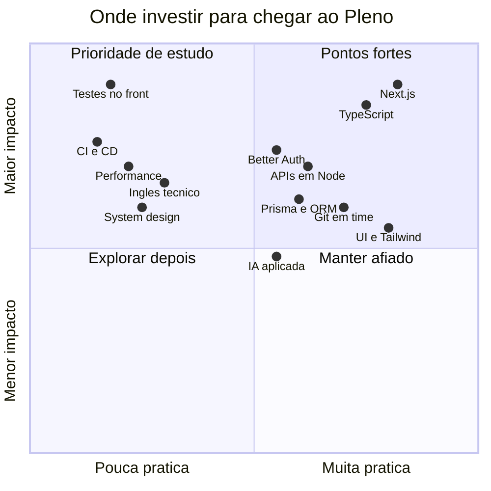

</details>

<!-- AUTO:regua:START -->


<details>
<summary><b>✅ Competências e evidências</b></summary>
<br>

| Competência de Pleno | Status | Evidência |
| --- | :---: | --- |
| Next.js (App Router) + TypeScript em projeto de time | ✅ | RKF Bank: landing, login, cadastro, abertura de conta e tela da conta (25/09 a 14/10/2026) |
| UI com Tailwind CSS, shadcn/ui e identidade visual própria | ✅ | RKF Bank (`483a3d1` aplica a marca RKF) e portfólio pessoal |
| Integração com API REST por camada de serviço tipada | ✅ | RKF Bank `frontend/lib/api` + proxy `/api` no Next (decisão de 11/10) |
| Autenticação e autorização com Better Auth | ✅ | treinos-api (Better Auth) |
| Modelagem de banco com ORM e migrações | ✅ | BellaFlow (Prisma 7 + Neon) e treinos-api (Prisma) |
| API em Node.js com validação e documentação | ✅ | treinos-api: Fastify + Zod + Swagger/Scalar + Prisma (bootcamp Full Stack Club) |
| Git em time: branches, Pull Requests e commits semânticos | ✅ | RKF Bank: PRs #1 a #23 com o Kevin, branches `feature/*` e `docs/*` |
| Logs com dados pessoais mascarados (LGPD) | ✅ | RKF Bank `frontend/lib/logger/mascara.ts` (CPF, e-mail, telefone e nome) |
| Documentação técnica e registro de decisões | ✅ | RKF Bank `planing/` (decisões, recados, contrato da API) e revisão da documentação (`7a5f1a8`) |
| Software que resolve um problema real do negócio | ✅ | sistema interno que uso no meu trabalho (projeto privado) |
| IA aplicada ao produto e ao fluxo de trabalho | ✅ | treinos-api `src/routes/ai.ts` (AI SDK) e CLAUDE.md/AGENTS.md nos projetos |
| Testes automatizados no frontend (Vitest + Testing Library) | 🔄 | primeiro teste com Vitest num projeto pessoal; o RKF Bank ainda não tem testes no front |
| Segurança de dependências do frontend | 🔄 | CVEs do `next` 16.3.6 mapeadas nos débitos do RKF Bank; correção pendente |
| Arquitetura de software e system design | 🔄 | Imersão Arquitetura de Software com IA (Full Stack Club, 26/09/2026, 6 h); falta aplicar num projeto |
| Inglês técnico | 🔄 | Nível básico, em estudo (currículo) |
| CI do frontend (lint, typecheck e build em todo PR) | ⏳ | débito registrado no RKF Bank |
| Testes end-to-end (Playwright) | ⏳ |  |
| Performance medida (Core Web Vitals / Lighthouse) | ⏳ |  |
| Deploy fora da Vercel (Docker, nuvem) | ⏳ | decisão "onde publicar" em aberto no RKF Bank |

<sub>✅ praticado em projeto · 🔄 em andamento · ⏳ planejado · gerado do meu Obsidian em 2026-10-17</sub>

</details>
<!-- AUTO:regua:END -->

<!-- AUTO:estudos:START -->
<details>
<summary><b>📚 Mapa vivo dos meus estudos (sincronizado com o Obsidian)</b></summary>
<br>

**8** praticados em projeto · **4** em andamento · **2** planejados

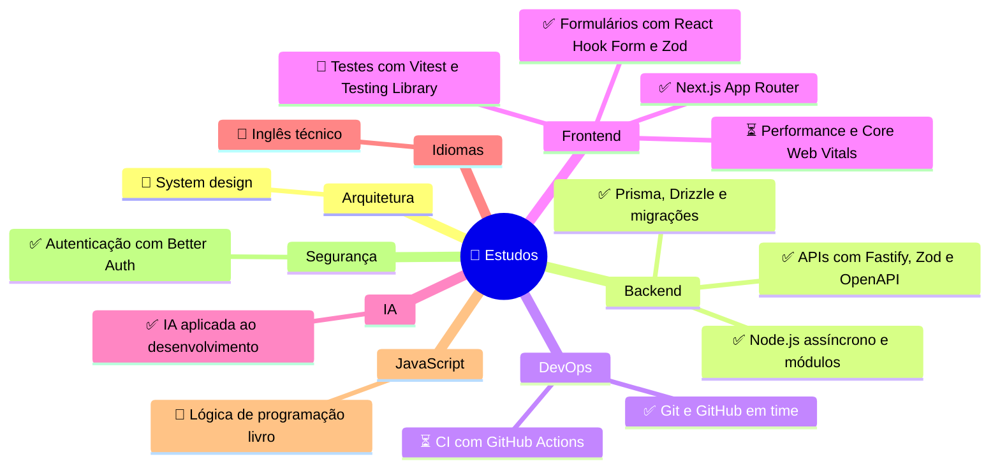

| Estudando agora | Área | Próximo passo |
| --- | --- | --- |
| 🔄 System design | Arquitetura | Redesenhar o RKF Bank pensando em escala (cache, réplica de leitura) |
| ⏳ CI com GitHub Actions | DevOps | Criar o workflow do frontend do RKF Bank: lint, typecheck e build |
| ⏳ Performance e Core Web Vitals | Frontend | Rodar o Lighthouse na landing do RKF Bank e anotar LCP, CLS e INP |
| 🔄 Testes com Vitest e Testing Library | Frontend | Escrever o primeiro teste do `use-cadastro-form` no RKF Bank |
| 🔄 Inglês técnico | Idiomas | — |
| 🔄 Lógica de programação (livro) | JavaScript | — |

</details>
<!-- AUTO:estudos:END -->


## 📊 GitHub Stats

<div align="center">


</div>


## 🎯 PDI — Roadmap 2026

> *Objetivo:* consolidar a transição de carreira para **Full Stack** e chegar ao **Pleno** com evidências em projeto.

| Pilar | Foco | Status |
| --- | --- | --- |
| ⚛️ Frontend | Next.js, testes no front, performance |  |
| 🧩 Backend | Node.js, APIs, banco e autenticação |  |
| 🛡️ Qualidade | CI, testes e segurança de dependências |  |
| 🏗️ Arquitetura | system design aplicado |  |
| 🤖 IA aplicada | tool calling, agentes e produtividade |  |
| 🌎 Inglês | leitura técnica e conversação |  |

<details open>
<summary><b>📅 Cronograma: do MVP do RKF Bank ao Pleno</b></summary>
<br>

<!-- AUTO:gantt:START -->
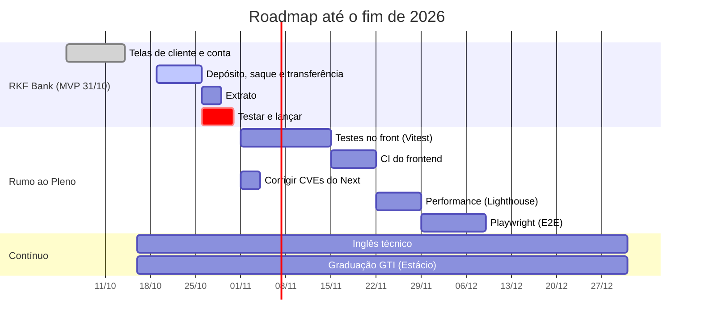
<!-- AUTO:gantt:END -->

</details>

<details>
<summary><b>✅ Checklist público do que falta (sincronizado com o meu Obsidian)</b></summary>
<br>

<!-- AUTO:checklist:START -->
**🚀 MVP do RKF Bank (31/10/2026)**: 8 de 20 itens prontos

<details>
<summary><b>Base</b> <sub>✔️ concluído</sub></summary>
<br>

- [x] Setup do frontend — 2026-09-25
- [x] Landing page institucional com a identidade da marca — 2026-10-06
- [x] Página de login (visual) — 2026-10-06
- [x] Cliente HTTP e serviços de clientes e contas — 2026-10-06

</details>

<details open>
<summary><b>Cliente e conta</b> <sub>3 a fazer</sub></summary>
<br>

- [x] Tela de cadastro (endereço pelo CEP) — 2026-10-11
- [x] Logs no frontend com dados mascarados — 2026-10-12
- [x] Tela de abertura de conta — 2026-10-14
- [x] Tela da conta (saldo, dados e ID para transferências) — 2026-10-14
- [ ] Decidir como o usuário volta para a conta: o Kevin registrou a decisão do login em 16/10 (`cb615d7`), falta conferir
- [ ] Integrar o login (CPF + senha, JWT) no frontend: o backend ficou pronto em 16/10
- [ ] Trocar a busca página a página por `GET /contas/{contaId}` quando o endpoint existir

</details>

<details open>
<summary><b>Movimentações</b> <sub>4 a fazer</sub></summary>
<br>

- [ ] Tela de depósito
- [ ] Tela de saque
- [ ] Tela de transferência
- [ ] Tela de extrato

</details>

<details open>
<summary><b>Lançamento</b> <sub>5 a fazer</sub></summary>
<br>

- [ ] Decidir onde publicar (site, API e banco)
- [ ] Fellipe testa tudo pelo roteiro E2E
- [ ] Corrigir os bugs encontrados
- [ ] Colocar no ar
- [ ] Atualizar o README com link e prints

</details>

**🧹 Débitos técnicos do front mapeados:** 5

<sub>🤖 Sincronizado com o checklist do meu Obsidian em 2026-10-17.</sub>
<!-- AUTO:checklist:END -->

</details>

<details>
<summary><b>⚛️ Próximo foco no frontend</b></summary>
<br>

- [x] componentes, hooks e formulários com validação;
- [x] camada de API tipada e proxy no Next;
- [x] logs com dados mascarados;
- [ ] testes com Vitest e Testing Library (primeiro alvo: `use-cadastro-form`);
- [ ] CI do front: lint, typecheck e build em todo PR;
- [ ] login com JWT integrado ao backend;
- [ ] performance medida com Lighthouse (LCP, CLS e INP);
- [ ] testes end-to-end com Playwright.

</details>

<details>
<summary><b>🏗️ Arquitetura — ver detalhes</b></summary>
<br>


- Fiz a **Imersão Arquitetura de Software com IA** (Full Stack Club): um encurtador de URLs pensado para 11.600 leituras e 1.160 escritas por segundo, do desenho ao deploy na AWS.
- Estimativa de capacidade, escala horizontal, balanceamento de carga e réplica de leitura.
- Próximo passo: aplicar esse raciocínio num projeto meu, começando pelo RKF Bank.

</details>

<details>
<summary><b>🤖 IA aplicada — ver detalhes</b></summary>
<br>


- **No produto:** IA com *tool calling* na Treinos API e automação com n8n no BellaFlow.
- **No dia a dia:** uso assistentes com regras de projeto (`CLAUDE.md`, `.claude/rules`) para manter o padrão de código, e reviso criticamente o que a IA gera.
- **Este perfil:** o README se atualiza sozinho a partir das minhas notas no Obsidian.

</details>


## 🛠️ Tecnologias

<div align="center">

[](https://skillicons.dev)

</div>

<details>
<summary><b>🧠 Mapa mental da stack</b></summary>
<br>

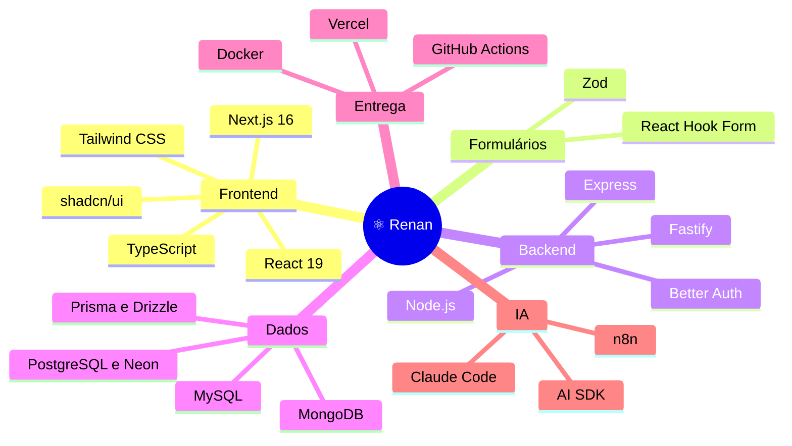

</details>

<details>
<summary><b>Ver a stack por categoria</b></summary>
<br>

| Categoria | Tecnologias |
| --- | --- |
| Frontend | Next.js · React · TypeScript · Tailwind CSS · shadcn/ui · React Hook Form · Zod · TanStack Query · Framer Motion |
| Backend | Node.js · Fastify · Express · Prisma · Drizzle · Better Auth · APIs REST |
| Dados | PostgreSQL · Neon · MySQL · MongoDB |
| Infra | Vercel · Docker · GitHub Actions |
| Ferramentas | Git · GitHub · VS Code · Cursor · Claude Code · Figma · n8n |

</details>


## 💼 Atuação profissional

Atuo como **Assistente Financeiro numa transportadora em Osasco**, onde entrei como jovem aprendiz em 2023 e fui promovido quatro vezes. É lá que eu vejo, todo dia, o problema real por trás do software: rotina repetitiva, planilha que ninguém confia e dado espalhado.

| Área | O que eu levo para o código |
| --- | --- |
| Processos | faturamento semanal, notas fiscais e agendamentos: entendo a regra de negócio antes de codar |
| Dados | planilhas de acompanhamento: sei o valor de um dado confiável e bem organizado |
| Entrega | quatro promoções em três anos: responsabilidade e constância |
| Colaboração | trabalho em dupla no RKF Bank: contrato de API, PRs e decisões por escrito |
| Evolução | estudo todos os dias: graduação, formações e projetos próprios |
| Inglês | básico, em desenvolvimento ativo |


## 💬 Pergunte ao Renan

> Perguntas que costumam aparecer em entrevista, respondidas com o que eu fiz de verdade. Clique para abrir.

<details>
<summary><b>Por que o frontend do RKF Bank chama o backend por um proxy?</b></summary>
<br>

O navegador chama `/api/...` no próprio Next, que repassa para o backend. Assim o navegador nunca fala direto com outra origem (sem dor de cabeça com **CORS**) e o **endereço do backend não fica exposto** no cliente. Registramos essa decisão em 11/10 no `planing/decisoes.md`.

</details>

<details>
<summary><b>Como você evita vazar dados pessoais nos logs?</b></summary>
<br>

Todo log do frontend passa por `lib/logger`, e o logger aplica `mascararDadosPessoais` **antes** de escrever. Quem loga não precisa lembrar de mascarar: CPF vira `***.***.247-25`, e-mail vira `j***@dominio.com`. Para proteger um campo novo, basta adicioná-lo ao mapa de máscaras. É a LGPD aplicada no dia a dia de debug.

</details>

<details>
<summary><b>Sem login no MVP, como o usuário volta para a conta dele?</b></summary>
<br>

Hoje a conta aberta fica guardada no navegador e a tela da conta a recupera por um hook (`use-conta-atual`). Tem um ponto fraco, e ele está registrado nos débitos técnicos: como ainda não existe `GET /contas/{contaId}`, a tela procura a conta página a página. Assim que o endpoint existir, vira uma chamada só. O próximo passo é integrar o login com JWT, que o Kevin já está implementando no backend.

</details>

<details>
<summary><b>Como funciona o personal trainer de IA da Treinos API?</b></summary>
<br>

A IA não responde "de cabeça". Ela tem *tools* tipadas que chamam os mesmos *use cases* da API: primeiro `getUserTrainData` para saber se a pessoa já tem dados, depois salva peso e altura se faltar, e só então `createWorkoutPlan` grava o plano no banco. O modelo conversa; quem decide o que é salvo é o código.

</details>

<details>
<summary><b>Como é trabalhar em dupla, um no front e outro no back?</b></summary>
<br>

O segredo foi **combinar antes de codar**: o contrato da API é a fonte da verdade, as decisões ficam escritas com data e motivo, e dúvidas viram recados num arquivo do repositório. Um exemplo real: eu vi que um campo do JSON não batia com o contrato (`enderecoResponseDto` × `endereco`), deixei o recado e o Kevin ajustou o backend.

</details>

<details>
<summary><b>O que muda para quem vem de outra área?</b></summary>
<br>

Eu chego sabendo **por que** a tela existe. Antes de ser dev eu era o usuário: conferia nota fiscal, montava faturamento e sofria com planilha. Isso me faz perguntar "qual problema isso resolve?" antes de "qual biblioteca eu uso?".

</details>


## 🎓 Formação e certificações

| Quando | O quê | Onde |
| --- | --- | --- |
| 2024 → 2027 | Graduação tecnológica em **Gestão da Tecnologia da Informação** | Estácio |
| 03/2026 | **Formação Full Stack** (140 h): HTML, CSS, JavaScript, TypeScript, React, React Native, Node.js e Git · certificado reconhecido pelo MEC | DevClub |
| 2025 → hoje | Formações e projetos práticos: React, Full Stack, SOLID, IA para devs e mais | Full Stack Club |
| 09/2026 | **Imersão Arquitetura de Software com IA** (6 h): system design, load balancing, replicação e deploy na AWS com Fargate | Full Stack Club |

<br>

<div align="center">


<a href="https://www.linkedin.com/in/renan-costa-barros"></a>
<a href="mailto:renanbarros.tech@gmail.com"></a>


</div>
